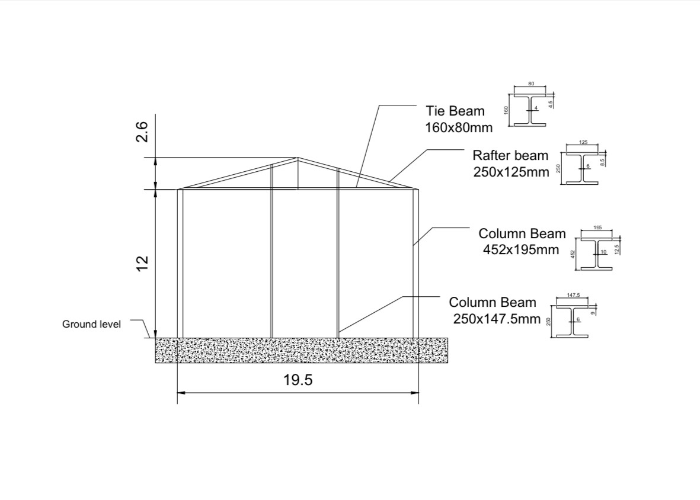
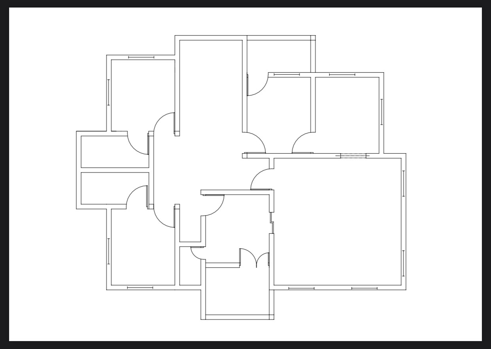

# autocad_engineering_drawings
# Mechanical & Engineering CAD Portfolio

A selection of my 2D AutoCAD drawings: mechanical components, structural steelwork,
site and plant layouts, and building plans. 

**Tools:** AutoCAD 2D  
**Skills shown:** orthographic and sectional views, dimensioning, hatching, centre lines,
machining symbols, structural sections, site layouts and legends.

Kolawole Samson Bolarinwa · B.Sc. Mechanical Engineering ·
[LinkedIn](https://linkedin.com/in/kolawole-bolarinwa-b1bb30138)

---

## Mechanical parts

### 01 · Bearing housing — section and plan view
*Practice exercise*

Sectioned front view and plan view of a housing with a curved bearing seat, fillet radii
(R15–R90), M16 tapped holes, end lugs and machining symbols on functional surfaces.

### 02 · Flanged hub — sections A-A and B-B
*Practice exercise*

Ø896 mm flanged hub with a Ø444 mm hub and Ø247 mm bore, and two bolt-hole sets
(4 × Ø75 mm and 4 × Ø100 mm). Two cutting planes show each hole set in section.

---

## Structural

### 03 · Steel portal-frame shed — elevation and member sections
*Practice exercise*

Elevation of a 19.5 m span portal-frame building (12 m eaves height, 2.6 m roof rise),
with I-section details for the columns, rafters and tie beam.

---

## Site and plant layouts

### 04 · CNG refuelling station — site layout
*Client project (freelance)*

Site layout for a compressed natural gas station: dryer, compressor and buffer storage,
gas pipeline routing to five dispensers, crash barriers, and separate 8 m entry and exit gates.

### 05 · Plant facility layout
*Tower Alloys Nigeria Ltd — contributed AutoCAD drafting for facility-layout modifications during my internship*

Layout of a casting and rolling plant showing casters, rolling mills, annealing furnace,
machine shop, electrical rooms, utilities and recast/dross handling areas.

### 06 · Plant layout — furnace and generator area
*Tower Alloys Nigeria Ltd — internship*

Section of the plant layout showing the preheater furnace, emulsion filter, generator bays,
electrical control room, cooling tower and a proposed 40,000 L storage tank.

---

## Buildings

### 07 · Proposed extension for police mobile unit
*Tower Alloys Nigeria Ltd — project development work*

Proposed two-room extension (3.0 m + 3.6 m × 3.5 m) in plan, front and back views,
with 900 mm doors, window schedule and 3.0 m wall height.
[View PDF](buildings/07-police-mobile-unit-extension.pdf)

### 08 · Residential floor plan
*Practice exercise*

Floor plan of a multi-room residence showing walls, door swings and window positions.